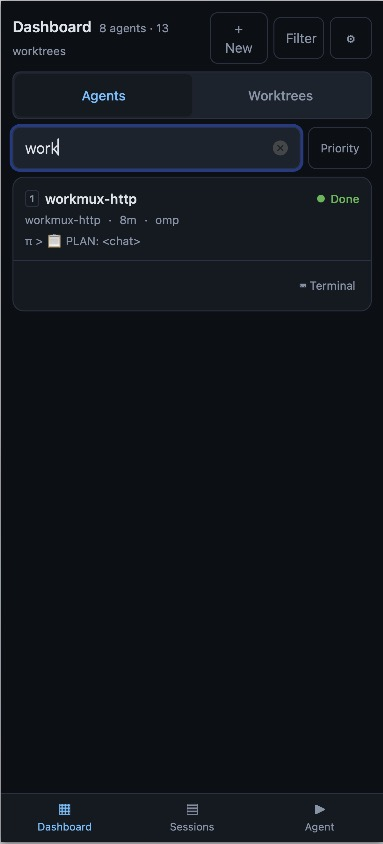
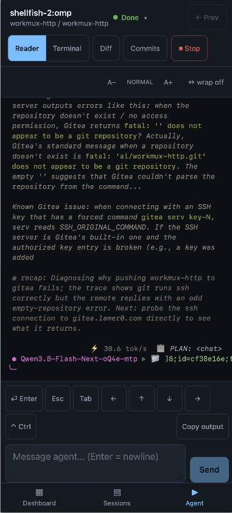
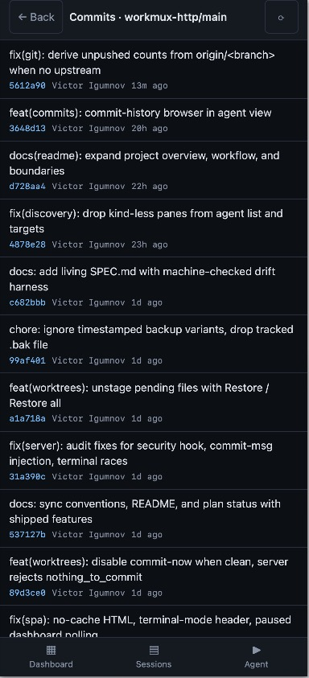
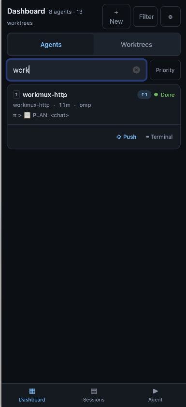

# workmux-http

iPhone-first web control plane for your existing
[workmux](https://github.com/raine/workmux)/tmux coding-agent sessions. Check
progress, reply to agents, review changes, and manage worktrees from your phone
without replacing the terminal workflow already running on your development
machine. Self-hosted over your VPN; no app login.

## Screenshots

<table>
  <tr>
    <td></td>
    <td></td>
    <td></td>
  </tr>
  <tr>
    <td></td>
    <td></td>
    <td></td>
  </tr>
</table>

## What this project is

workmux-http is a **mobile companion to workmux**, not a new agent runtime.
workmux and tmux remain the source of truth for managed sessions; git provides
repository state. The dashboard discovers that existing fleet and exposes the
actions you need when you step away from your desk.

Its focus is the combination of:

- **Existing-session discovery** — use agents already tracked by workmux;
  adopting them in the dashboard does not require restarting them through a
  separate launcher. Ordinary, untracked tmux panes are not agent targets.
- **Phone-native interaction** — responsive browser views for fleet status,
  captured output, message composition, diffs, and confirmations, rather than
  squeezing the whole desktop TUI onto a portrait screen. These are web views,
  not a native iOS app.
- **Reader and Terminal as explicit modes** — read and reply comfortably by
  default; enter a real interactive terminal when the task needs terminal
  fidelity. Switching modes preserves the Reader's draft and scroll position.
- **Review alongside conversation** — inspect WIP or branch diffs, stage and
  split hunks, manage staged paths, and use the configured commit workflow
  without leaving the dashboard.
- **workmux lifecycle controls** — create, merge, and remove managed worktrees,
  with exact-target confirmation for consequential actions such as merge,
  removal, stopping an agent, and pushing commits.
- **Your machine, your network** — the server runs beside your tools; your
  phone reaches it through your private network. No hosted relay or separate
  dashboard account is required.

These are the project's design priorities, not a claim that no other tool
offers similar features.

## A typical workflow

1. **Start at your desk.** Run your normal workmux/tmux agent workflow on the
   development machine, then run workmux-http against the same tmux server.
2. **Check in from your phone.** Connect through your VPN and open the dashboard
   in the browser. Find the project, worktree, or agent that needs attention.
3. **Read and steer.** Open Reader, follow recent output, adjust text size or
   line layout (wrap / fit / scroll), and send a message or an explicit key through the composer.
4. **Review the result.** Inspect diffs, stage the intended changes, and either
   ask the agent to commit or use a configured direct-commit command. Review
   the listed commits before confirming a push; confirm lifecycle actions
   against their exact target.
5. **Drop into Terminal only when needed.** Use it for interactive terminal
   work, then return to Reader. Return to your desktop workflow whenever you
   need broader editing or debugging tools.

## Philosophy and boundaries

**Adapt the interaction, not the agent.** Reader presents captured pane output
in a browser-friendly surface. Three line layouts cover portrait screens:
wrap for prose (soft-wrapped continuations are indented so they read apart
from new terminal lines), fit (the font shrinks so full terminal lines fit the
screen width, keeping borders and tables aligned), and scroll for fixed-size
horizontal swiping. Reader still does not reconstruct structured
conversations or reliably reflow TUI tables, borders, and cursor-driven
layouts. Terminal preserves a terminal grid instead.

**Do not silently rearrange the desktop.** Rotation and keyboard changes do
not automatically resize the shared terminal. Resizing is explicit and
confirmed because it affects other clients. Terminal is session-wide, not an
isolated agent sandbox: its banner identifies the active pane receiving input,
which may differ from the agent you initially opened.

**Keep the human in consequential decisions.** Confirm the exact target and
warnings, revalidate before executing, and surface uncertain delivery rather
than silently resending a message. Unavailable repository data is not treated
as a clean worktree.

### What it is not

- **Not a replacement for workmux, tmux, or your agents.** It does not supply a
  model, agent runtime, or universal adapter for every coding tool; agent
  discovery depends on workmux's managed records.
- **Not a full mobile IDE or complete workmux TUI clone.** The goal is to
  supervise, steer, review, and perform focused actions, not reproduce every
  desktop editor, debugger, or workmux command. See the parity table below for
  current gaps.
- **Not a semantic chat client.** Reader captures terminal text, not an agent's
  structured conversation API; it cannot promise lossless chat reconstruction
  or perfect reflow of arbitrary terminal output.
- **Not a general-purpose SSH client or multi-host fleet service.** One server
  operates against its configured tmux server and local tools; it is not a
  phone-side SSH connection manager or a built-in aggregator of remote hosts.
- **Not a public, multi-user service.** There is no app authentication or
  per-user authorization. Anyone able to reach the allowed endpoint is inside
  the trust boundary; Host/Origin checks do not replace a VPN or access control.
  Origin checks compare scheme+host+port against the plain-HTTP server, so
  `https:` Origins are rejected — terminate TLS elsewhere only if you also
  rewrite `Origin`. Do not expose it directly to the public internet.

## Quick start

```sh
npm install
npx node-gyp rebuild --directory node_modules/node-pty   # approve native build if npm asks
npm run build
npm start                                                 # http://127.0.0.1:3000
```

To run it unattended as an OS service (launchd / systemd / FreeBSD rc.d),
see [`deploy/README.md`](deploy/README.md).

Dev mode (API watch + Vite with `/api` + WS proxy):

```sh
npm run dev    # http://127.0.0.1:5173
```

`dev` and `start` both bind the API to port 3000 by default — stop one before
starting the other, or run them side by side with e.g.
`WORKMUX_HTTP_PORT=3001 npm run dev` (the Vite proxy follows the same
variable). `/` only serves the SPA from `npm start` (built `dist/public`);
during `npm run dev` open **5173**, not 3000.

## Prerequisites

External binaries are resolved from `PATH` at runtime. Required tools fail the
dashboard's health sources when missing; optional ones degrade honestly
(the affected feature reports unavailable — nothing is fabricated).

| Tool | Required | Minimum | Used for | Verify |
| --- | --- | --- | --- | --- |
| `tmux` | **yes** | 3.2 (needs `paste-buffer -p`) | session/pane discovery, output capture, message delivery, owned advanced-terminal sessions | `tmux -V` |
| `workmux` | **yes** | recent release | agent + worktree discovery (`list-all`, `status --all`) | `workmux --version` |
| `git` | **yes** | 2.11 (needs `status --porcelain=v2`) | worktree status, diffs, hunk staging, merge, push | `git --version` |
| `gh` | optional | — | GitHub PR/CI overlay on cards and clean-sweep evidence; must be authenticated (`gh auth login`); `github.com` remotes only | `gh auth status` |

Also needed:

- **Node ≥ 22** and npm (lockfileVersion 3). macOS and Linux; Windows is not
  supported (POSIX tmux sockets).
- **Native build toolchain** — Python 3, `make`, and a C++ compiler (Xcode
  Command Line Tools on macOS: `xcode-select --install`) to compile
  `node-pty`. Approve the build script when npm prompts (`allowScripts` is
  pinned in `package.json`) or rebuild explicitly:
  `npx node-gyp rebuild --directory node_modules/node-pty`. Without the
  native binding everything works **except** the advanced terminal, which
  refuses to attach.
- A **running tmux server** that already hosts your workmux sessions — the
  default socket is auto-detected, or set `WORKMUX_TMUX_SOCKET` explicitly.

No tmux/workmux installed? Run fixture mode with
`WORKMUX_HTTP_FIXTURES=$PWD/fixtures` — the dashboard renders committed
sample data instead (see [Environment](#environment)); the advanced
terminal and sweep endpoints refuse in fixture mode.

On startup the server probes these tools and prints what's wrong instead of
failing silently — `WARNING:` on stderr for missing/too-old required tools
(it still boots; `/api/health` keeps reporting the degraded sources),
`note:` on stdout when the optional `gh` is absent:

```
workmux-http listening on http://127.0.0.1:3000
WARNING: tmux: not found on PATH (required) — no sessions, panes, or message delivery; see README Prerequisites
WARNING: workmux: not found on PATH (required) — agent/worktree discovery will report dependency_error
WARNING: git: not found on PATH (required) — status, diffs, staging, merge, and push are unavailable
note: gh: not found — GitHub PR/CI status stays disabled (optional)
```

## Environment

| Variable | Default | Purpose |
| --- | --- | --- |
| `WORKMUX_HTTP_BIND` | `127.0.0.1` | Listen address. Wildcard (`0.0.0.0`/`::`) is **refused** unless… |
| `WORKMUX_HTTP_ALLOW_WILDCARD` | unset | …set to `1` to opt in. You MUST also set `WORKMUX_ALLOWED_HOSTS` — the Host allowlist stays enforced, so without it every request 403s. Prefer binding the specific VPN/LAN address instead. |
| `WORKMUX_HTTP_PORT` | `3000` | Port. |
| `WORKMUX_ALLOWED_HOSTS` | localhost + `127.0.0.1`/`[::1]` | Comma-separated exact Host names/IPs accepted (add your VPN/LAN address). Special value `*` accepts **any** Host — see warning below. |
| `WORKMUX_TMUX_SOCKET` | auto (`tmux display-message -p '#{socket_path}'`) | Explicit tmux socket path. |
| `WORKMUX_REPOS` | auto-discovered from workmux | Comma-separated project roots (informational). |
| `WORKMUX_HTTP_FIXTURES` | unset | Directory with `list-all.json`, `status-all.json`, `output-<paneId>.txt` → fixture mode (no tmux/workmux needed; sends are simulated). |
| `WORKMUX_HTTP_STALE_AFTER` | `3600` | Seconds after which an agent's status report is treated as stale (per-agent `Stale` badge; worktrees with no recent update count as idle). |
| `WORKMUX_HTTP_MAX_OWNED_TERMINALS` | `4` | Concurrent advanced-terminal (`wmhttp-adv-*` owned) sessions allowed; further attaches are refused with the limit in the error. |
| `WORKMUX_<KIND>_COMMIT_CMD` | **unset = off** | **Default off:** with none set, every worktree keeps the existing agent-commit path (send `commit` to the agent). Direct-commit command for agent kind `<KIND>`: `WORKMUX_OMP_COMMIT_CMD` / `WORKMUX_OPENCODE_COMMIT_CMD` (interchangeable — workmux reports opencode as `omp`), `WORKMUX_CLAUDE_COMMIT_CMD`, `WORKMUX_CODEX_COMMIT_CMD`, or any other kind uppercased with non-alphanumerics → `_`. When set for a worktree's agent kind, the diff view's Commit becomes a message box running this command in the worktree (the commit message replaces the `{{COMMIT_MSG}}` token where present, appended otherwise; whole-token is safest, substring works inside shell wrappers with context escaping). The command must be an executable on the server's PATH — spawned with **no shell**, so shell functions/aliases (`.zshrc`) never resolve; env vars the command needs must be exported to the server process. To reference a zsh function anyway: `WORKMUX_OMP_COMMIT_CMD="zsh -ic 'opencode-commit -a \"{{COMMIT_MSG}}\"'"` (interactive zsh loads `~/.zshrc`; the placeholder is substituted inside the `-c` string, shell-escaped per quoting context). |
| `WORKMUX_COMMIT_TIMEOUT_MS` | `300000` | Timeout for the direct-commit command (AI commit tools can run minutes). |
| `WORKMUX_<KIND>_PUSH_CMD` | **unset = plain `git push`** | Per-kind push command (same kind resolution + `OMP`↔`OPENCODE` aliasing as the commit vars). Tokens: `{{BRANCH}}` and `{{REMOTE}}` (the remote picked in the push dialog; defaults to upstream→origin→sole) — whole-token = one argv element, substring = context-escaped inside shell wrappers; no `{{BRANCH}}` token → branch appended last; no `{{REMOTE}}` token → the command owns the remote and the picker locks. The wrapper owns flags (`-u` etc). To inherit your zsh like the commit path: `WORKMUX_OMP_PUSH_CMD="zsh -ic 'git push -u {{REMOTE}} {{BRANCH}}'"`. |
| `WORKMUX_PUSH_TIMEOUT_MS` | `120000` | Timeout for `git push` (network-bound). |

### VPN access model

The server binds loopback only by default. Reach it from your phone by
forwarding the VPN tunnel to loopback (e.g. WireGuard `ListenPort` proxy,
`ssh -L`, or tailscale serve) **or** bind to the VPN interface address and add
it to `WORKMUX_ALLOWED_HOSTS`. There is no app authentication — the network
boundary is the security boundary, so do not expose this on a public interface.
HTML responses carry `Cache-Control: no-store` (Safari always gets the fresh
bundle after a rebuild; hashed assets are `immutable`, cached forever), so a
plain reload after `npm run build` is enough — no restart needed for frontend
changes.
Mutations additionally require a same-origin request carrying
`x-workmux-request: 1`; foreign `Host` headers are rejected (DNS-rebinding
protection).

> ⚠️ **`WORKMUX_ALLOWED_HOSTS=*` disables that last protection.** With no
> login, any page you visit on a network that can reach this port can
> DNS-rebind its own domain to your host, appear same-origin, and drive your
> agents (send messages, merge, remove worktrees). Only use `*` on networks
> you fully trust; the server prints a startup warning when it is set.

## What it shows / does

- **Dashboard** — every managed agent (agent kind badge, status, elapsed, branch,
  dirty state) and every worktree (branch, uncommitted, PR/CI status), searchable, filterable,
  sortable; preferences persist per tab. Only panes workmux recognizes as
  agents (with an `agent_kind`) are listed — kind-less records such as a
  plain zsh pane running your dev server are filtered out (they aren't
  message targets either).
- **PR/CI status** — when the `gh` CLI is installed and authenticated, cards
  show the branch's pull request (number, open/draft/merged/closed, review
  decision, link) and CI rollup for the exact local commit (passing/failing/
  pending with counts, per-check links, checked SHA). States are honest:
  unknown checks never render as passing, a local commit GitHub hasn't seen
  is unknown (not green), expired data is labeled outdated, and branches on
  non-GitHub remotes are disclosed as unsupported. GitHub being unreachable
  never affects the core tmux/workmux connection indicator. Only
  `github.com` is supported in this release; only the worktree's own
  remotes are ever queried. Agent cards reserve a single PR/CI row even
  when status is absent. The row stays the same height during refreshes
  and scrolls horizontally for long content. Opening the per-check list
  expands the card. Refresh cadence is
  load-aware: active results
  (a PR exists or CI is pending) re-check every 60 s; a **conclusive
  negative** (no PR and no pending CI) waits 5, 10, 20, then 30 minutes
  between repeated results. Repeated failures start at 15 seconds and
  double up to 5 minutes, even when the last good result is still shown.
  A new commit gets a fresh check. Unsupported remotes make zero GitHub
  requests and recheck local remote configuration once a minute.
- **Clean sweep** — the Worktrees tab's *Clean sweep* button scans the
  currently displayed worktrees for provably clean removal targets: merged or
  closed PR (exact HEAD), vanished upstream branch, or local merge into the
  base branch. Dirty work, live agents, open windows, conflicts, rebase
  operations, main/base worktrees, and unverifiable GitHub state are always
  shown as blockers — never silently dropped. Review before removal lists the
  exact targets and warnings (directory deletion includes Git-ignored files;
  open windows close). **Branches are kept by default**; deleting branches
  requires unchecking *Keep local branches* and re-review, and only removes a
  branch whose HEAD is proven an ancestor of the base. Removal runs
  `workmux remove` **without force — a force path does not exist** — and each
  target is re-verified immediately before its removal. Results are per-item
  and honest: `removed` requires a postcondition check (directory gone,
  branch present/absent per your choice), ambiguous outcomes (timeout,
  truncated output, server restart) render as *uncertain* and are **never
  retried**, and a mixed run never collapses into a success message. Closing
  the browser mid-sweep does not cancel it — reopening the sheet resumes
  progress reporting. Fixture mode refuses sweep endpoints entirely.
- **Commits** — agent-view button opening the worktree's `git log` (newest
  first, up to 50 shown); each commit opens its diff vs the first parent
  (merge commits show parent-1 changes; root commits diff against the empty
  tree). Read-only history view — no staging or worktree actions there.

- **Themes** — ten palettes in two groups: dark — Night (default), Gruvbox,
  Twilight, Dracula, Catppuccin Mocha; light — GitHub Light, Solarized
  Light, Catppuccin Latte, One Light, Gruvbox Light — switchable from the ⚙
  sheet on the dashboard (every palette is WCAG-checked in tests: ≥7:1 body
  text, ≥4.5:1 muted text).
  The choice is durable (all tabs) and applies to every surface including the
  advanced terminal, native control color-scheme (scrollbars, form widgets),
  and the iPhone chrome tint.
- **Agent view** — one target, two modes (Reader / Terminal) via the header
  mode control; the route keeps target + mode together, and Reader stays
  mounted while Terminal is active (drafts and scroll position survive the
  round-trip). Reader: live scrollback capture (2 s poll) opening at the tail
  (latest output), follow-bottom with jump-latest, text-size presets
  (A−/A+, durable) and wrap toggle (durable; wrapping can break TUI borders),
  transient fetch errors keep the last snapshot with a visible notice,
  composer with per-agent drafts, one-shot Ctrl chord + key toolbar, literal
  send via atomic tmux paste buffer.
- **Diff view** — WIP (uncommitted) and Review (vs resolved base) unified diffs,
  per-hunk stage / unstage / split / undo, hunk comments, commit (direct via
  `WORKMUX_<KIND>_COMMIT_CMD` when configured — button disabled when there is
  nothing to commit; otherwise a literal `commit` sent to the owning agent),
  merge behind exact-target confirm.
  WIP mode additionally lists **pending changes** — untracked, unstaged, and
  staged files, with per-file *Add* / *Restore* and *Add all* / *Restore all*
  (Restore = unstage — `git restore --staged`, or `git rm --cached` before
  the first commit, so Restore works on unborn repos too; file content is
  always kept; conflicts are listed for awareness but the Add path rejects
  them — resolve conflicts first). A file's button
  flips Add ↔ Restore as its staged state changes.
  — and, when `WORKMUX_<KIND>_COMMIT_CMD` is configured for the worktree's
  agent kind, a **Commit now** box: optional message input (empty = the
  command runs with no message argument) → command runs async via the
  operations registry (spinner while it runs, failure surfaced inline under the
  bar; commit contents = exactly what the git index holds). The button is
  disabled when the worktree has nothing to commit (and the server rejects
  `nothing_to_commit` for stale views); it stays enabled when git status
  can't be read, since unknown ≠ clean. The command must
  be an **executable resolvable by the server process** — it is spawned
  directly, with no shell, so aliases and functions from your `.zshrc` are
  invisible to it. Two ways to use zsh functions anyway:
  - wrap the command in an interactive zsh (loads `~/.zshrc`; the
    `{{COMMIT_MSG}}` placeholder sits inside the quoted `-c` string and is
    substituted with shell-context escaping):
    `WORKMUX_OMP_COMMIT_CMD="zsh -ic 'opencode-commit -a \"{{COMMIT_MSG}}\"'"`
  - or generate a standalone script from the function once:
    `{ echo '#!/bin/zsh'; functions opencode-commit; echo 'opencode-commit "$@"'; } > ~/.local/bin/opencode-commit && chmod +x ~/.local/bin/opencode-commit`
- **Push** — agent cards show per-remote unpushed badges (`origin ↑2`, muted
  `github new` for a remote the branch was never pushed to; each remote with
  0 to publish is hidden), falling back to a single aggregate `↑N` badge when
  per-remote state is unavailable, and a `●N` badge when N files have changes
  to be committed (untracked + staged + unstaged + conflicts, each path
  counted once). The card's Push button opens a confirm dialog listing the
  exact commits that would be published (sha + subject, capped at 20; tap a
  commit with a body to expand the full message), a **remote picker**
  (radiogroup of configured remotes with per-remote counts / `new` /
  `upstream` tags, defaulting to upstream → `origin` → sole remote; an
  opt-in "set `<remote>` as upstream" checkbox governs `-u`), plus warnings —
  first push to the selected remote (`creates <remote>/<branch>`) and
  divergence (`<remote> has N newer commits`). Switching the remote
  re-prepares for a fresh token; when a per-kind push command owns the
  remote (no `{{REMOTE}}` token) the picker locks to a read-only target.
  Push always requires ticking "I confirm these commits are
  ready to push" — even with zero warnings. On confirm the dialog closes
  immediately and the card shows a pulsing `pushing…` indicator while the
  push runs async via the operations registry, ending in an inline ✓/error
  note. The confirmation token binds HEAD sha + commit list + selected remote
  + `-u` decision, so commits added — or the remote switched — after you open
  the dialog force re-review. Push always names the remote explicitly
  (`git push [-u] <remote> <branch>`), never bare. **No force-push code path
  exists**; a non-fast-forward is rejected by the remote and surfaced.
  A per-kind `WORKMUX_<KIND>_PUSH_CMD` replaces the built-in `git push`
  (e.g. an interactive-zsh wrapper, same pattern as the commit commands —
  see the env table); `{{REMOTE}}` receives the picked remote. `ahead`
  reflects the last local `git status` (remote
  refs move when something fetches).
- **Destructive actions** (merge, remove worktree, stop agent) always
  prepare → show exact target + warnings → confirm token → execute with
  re-validation; each token is single-use. No auto-retry anywhere; uncertain
  delivery is reported as `delivery_unknown` and never silently resent.
- **Advanced terminal** (`Terminal` mode on an agent) — real interactive tmux
  pane over WebSocket (xterm.js + node-pty) inside an owned grouped session
  (`wmhttp-adv-*`, marked `@wmhttp_owned`), so your desktop window selection is
  never changed. Entering never resizes the shared window: the pane attaches at
  the window's current size and a wider grid scrolls horizontally instead of
  reflowing. The only resize path is the explicit *Resize shared terminal…*
  action — it warns that it changes the layout for every client attached to
  the window, needs your confirmation, and the size label updates only after
  the server acknowledges (the proposal is measured from the visible
  viewport, never the horizontally-expanded grid). Owned sessions are excluded from the dashboard.
  The terminal is **session-wide**: tmux focuses the window's active pane,
  which can be a different agent's pane than the one you opened Terminal
  for — the header banner names the pane keystrokes are landing in and
  updates when it changes (nothing is ever silently re-targeted).
  While Terminal mode is open, dashboard polling pauses (the pane is live
  over WS, and the pty attach can stall `/api/dashboard` past the stale
  threshold); leaving Terminal forces an immediate refresh, so Terminal use
  never triggers a spurious "data may be outdated" banner.

## Architecture

- [Current-state specification](docs/SPEC.md): endpoints, security gates,
  invariants, state machines, and env vars.
- [Documentation index](docs/README.md): feature designs and implementation
  plans, their status, lasting decisions, and historical audits.

```
server/index.ts        routes (fastify), SPA fallback, WS /api/terminal
server/config.ts       env + bounds           server/security.ts  host/origin/header gates
server/exec.ts         argv-only spawn (no shell, ever)
server/adapters/       tmux.ts  workmux.ts  git.ts
server/services/       discovery.ts (2s TTL cache, stale markers)
                       input.ts (dedup, per-pane queue, revalidation)
                       management.ts (confirm tokens, hunks, create/merge/remove)
                       operations.ts (disconnect-safe registry)
                       terminal.ts (owned grouped-session pty attach)
shared/types.ts        single source of API contracts
src/                   React SPA (features/dashboard|agent|worktrees|terminal|palette)
```

Design decisions worth knowing:

- Delivery uses raw `tmux send-keys` / `load-buffer`+`paste-buffer -p -d`, not
  `workmux send` — upstream refuses to send to *waiting* agents (exit 3), and
  the dashboard intentionally allows messaging agents regardless of status.
  workmux is used for lifecycle (`add`, `merge`, `remove`, `close`, `open`).
- Git facts are computed per repository because upstream
  `workmux status --all --git` aborts entirely when any tracked workdir is not
  a git repository (verified against workmux 0.1.280).
- `AgentView.git === null` means *unavailable*, never *clean*. Missing data is
  shown as unavailable, never fabricated.
- The "Data may be outdated" banner reflects source/polling health only.
  Idle agents (past the stale threshold) get per-agent Stale badges — they
  do not claim the dashboard data itself is outdated.

## Verification

- `npm run test` — 556 vitest tests (unit + jsdom component + real-tmux
  integration on disposable sockets incl. terminal geometry audit,
  real-git hunk staging, path staging, the configurable commit runner,
  push against a local bare remote incl. first-push, drift re-confirmation,
  divergence, and no-origin blocking, native sweep removal semantics against
  real workmux (clean remove keeps branch, dirty refusal without force,
  branch deletion when not kept), the pure sweep-eligibility policy, and
  the sweep scan/prepare/execute state machine; plus the SPEC.md drift
  harness, which
  fails the suite when routes/env vars/error codes change without updating
  `docs/SPEC.md`, a core invariant lacks a test mapping, or a mapped test
  is renamed/deleted. The mapping also records coverage limits; reference
  checks do not establish behavior or replace running the tests).
- `npx playwright test` — 43 e2e tests at iPhone 13 viewport against the
  production build in fixture mode (dashboard, search, sessions, send flow,
  reader/terminal modes incl. mocked-WebSocket attach/confirm/resize,
  pending-changes + direct-commit contract and graceful degradation,
  push badge/contract paths incl. execute-token rejection,
  PR/CI badge lifecycle, clean sweep flow with all mutations intercepted
  (mixed per-item results, stale rejection, resume) plus a live proof the
  fixture server refuses sweep endpoints,
  theme switching + persistence,
  host/origin/header boundary, confirm-token rejection).
- `npm run typecheck` — app + server projects clean.

## workmux TUI parity

| TUI | Dashboard equivalent |
| --- | --- |
| `1-9` window select, `Tab` cycle | tap any agent card / header switcher (no window concept) |
| `d` dashboard | Dashboard tab |
| `o` open worktree | Worktrees tab, card actions, create sheet |
| `p` / `:` command mode | ⌘⇧P / `:` command palette |
| `s` status | connection banner + `/api/health` |
| `/` search | search field (project, name, branch) |
| `F`/`f` follow/unfollow | auto-follow at bottom; *Jump to latest* breaks it |
| `i` interrupt | agent header *⏹ Stop* (exact-target confirm) + composer `Ctrl+C` key |
| `Ctrl+u`/`Ctrl+d` scroll | native momentum scroll + jump buttons |
| `Enter` view agent | tap card |
| `j`/`k` navigate | scroll; `j`/`k` work in the palette |
| diff `Tab` | WIP / Review segmented control |
| diff `j`/`k` hunk nav | sidebar hunk chips + scroll |
| diff `c` commit | footer *Commit* (literal `commit` to owning agent) |
| diff `m` merge | footer *Merge* → exact-target confirm dialog |
| patch `y`/`n` | per-hunk *Stage* / *Skip* |
| patch `u` undo | *Undo* per staged hunk/piece |
| patch `s` split | *Split* into stageable pieces |

Known gaps (deliberate or not yet built): preview pane resize (`+`/`-`) —
replaced by wrap toggle and the confirm-gated *Resize shared terminal…*
action; bulk stage-all (`a`); open file from
patch view (`o`); session rename, rebase, reap-agents, reopen variants; the
workmux sidebar itself; palette navigation-only targets.

## Limits

- Output is polled capture (2 s), not a live stream; the advanced terminal is
  the live path.
- One dashboard poll per browser tab; sends are serialized per pane.
- Web mutations (merge/push/remove/commit/staging) serialize per worktree —
  a second confirmed action queues until the first operation completes.
- Clean sweep scans at most 100 worktrees at a time and removes at most 20
  per confirmed sweep; only one scan and one sweep run at a time. A sweep
  interrupted by a server restart reports *uncertain* — the dashboard can
  tell you what it confirmed, never what an unreachable process did.
- API reads time out after 15 s (a stalled network can never freeze
  polling); mutations have no client deadline — their delivery is decided
  by the server, never by an abort.
- Advanced terminal requires the native `node-pty` build and refuses to start
  in fixture mode.
- Entering Terminal mode never changes tmux window geometry (proved by the
  integration geometry audit); the confirm-gated *Resize shared terminal…*
  does resize the window for **all** attached clients, and that resize
  persists after you leave.
- Verified on desktop Chromium (headless, iPhone 13 viewport) and this macOS
  host against real tmux/workmux 0.1.280. **Not** verified on physical
  iPhone/iPad Safari — visual viewport keyboard avoidance and 44 px targets are
  implemented per spec but need a real-device pass.
